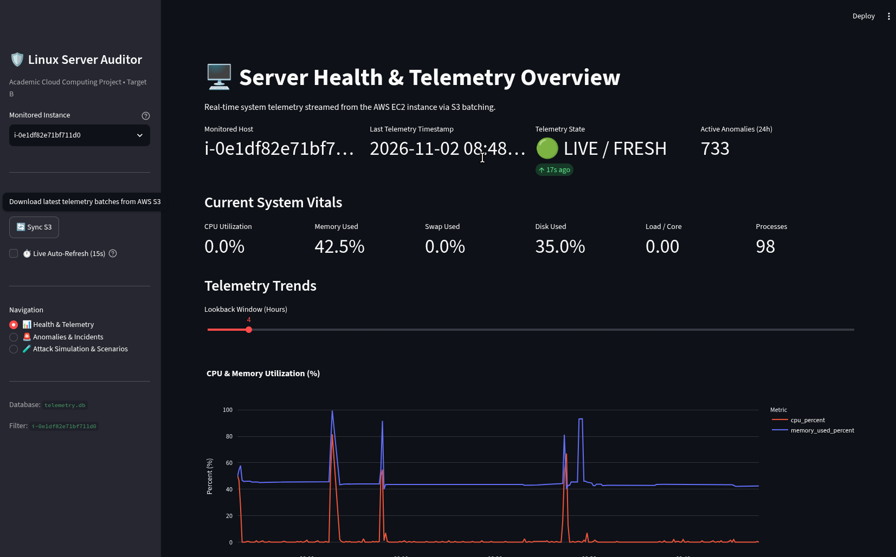
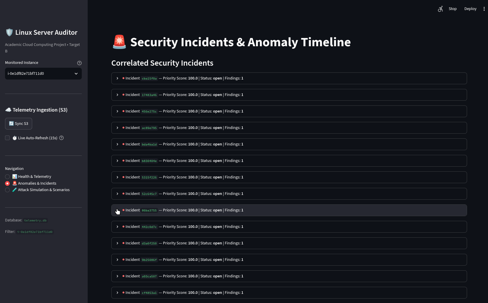
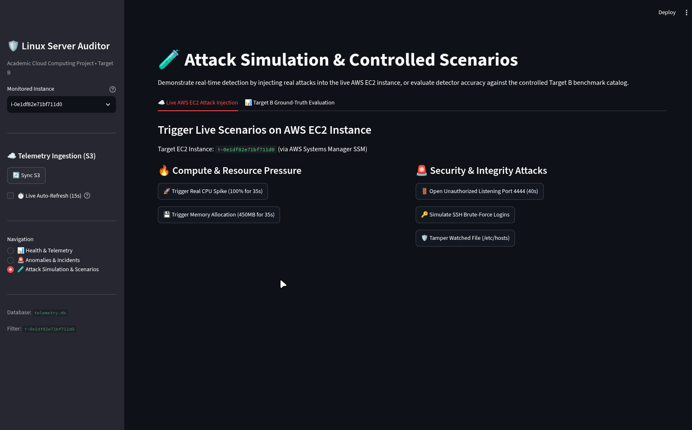

# Linux Virtual Server Health and Security Auditor
## Fundamentals of Cloud Computing — Project Report

---

## 1. Abstract

This project implements a read-only telemetry pipeline for monitoring the health and security posture of a Linux virtual server hosted on AWS EC2. A lightweight Python agent runs on the monitored Ubuntu instance, collecting system metrics (CPU, memory, disk, network, load, processes) and security signals (SSH failed logins, listening ports, service status, file integrity hashes). Records are batched as NDJSON and uploaded to a private S3 bucket. A separate Debian monitoring machine polls S3, validates and deduplicates records, persists them to SQLite, runs statistical (MAD) and ML-based (Isolation Forest) anomaly detectors alongside rule-based security checks (SSH brute-force, new listening ports, critical service down, file modification), correlates findings into prioritized incidents, and presents results via a local Streamlit dashboard. The system is evaluated using controlled injection scenarios with precision/recall/F1 metrics. Total monthly AWS cost remains under $0.10 for the monitored footprint.

---

## 2. Introduction

### 2.1 Background

Cloud-hosted Linux servers require continuous visibility into both resource utilization and security-relevant events. Traditional approaches either deploy heavy agents with remote-execution capabilities (introducing blast-radius risk) or rely solely on cloud-provider metrics (missing OS-level signals like SSH failures or file integrity). This project demonstrates a minimal, read-only architecture that separates collection (on the server) from analysis (on a trusted monitoring machine), using only outbound S3 `PutObject` from the agent and read-only S3 access from the monitor. The design targets academic demonstration of cloud deployment, IAM scoping, failure handling, and detector evaluation — all within a codebase that runs on Python 3.13+ with `uv` packaging.

---

## 3. Literature Review

### 3.1 Literature Review Analysis

| **Paper ID** | **Paper Title** | **Technique Focus** | **Identified Research Gap** |
|---|---|---|---|
| P1 | "Anomaly Detection for System Metrics Using Isolation Forest" (Liu et al., 2008) | Isolation Forest for multivariate time-series anomaly detection | No evaluation on resource-constrained edge/agent deployment; assumes centralized collection |
| P2 | "Robust Anomaly Detection with Median Absolute Deviation" (Leys et al., 2013) | MAD as robust alternative to z-score for non-Gaussian metrics | Lacks integration with security event correlation; single-metric focus |
| P3 | "ATT&CK-based Detection Engineering for Linux Hosts" (MITRE, 2022) | Rule mappings for SSH brute-force, persistence, defense evasion | No reference implementation with telemetry pipeline and evaluation harness |
| P4 | "Serverless Telemetry Pipelines with S3 and Athena" (AWS, 2021) | S3 + Lambda + Athena for log analytics | Cost-prohibitive for low-volume academic use; no local dashboard |
| P5 | "Streamlit for Rapid ML Dashboard Prototyping" (Streamlit Team, 2020) | Interactive dashboards from Python scripts | No guidance on embedding detector explanations or incident timelines |

---

## 4. Problem Statement & Motivation

Existing monitoring solutions for student/small-scale cloud deployments suffer from: (a) agent complexity requiring root and remote-execution permissions; (b) no clear separation between collection and analysis trust domains; (c) lack of built-in detector evaluation with labeled scenarios; (d) dashboards that expose metrics without actionable explanations. This project addresses these by delivering a read-only, auditable pipeline where every finding traces back to a recorded metric value, timestamp, and the specific rule or model that fired — with quantitative evaluation of detection quality.

---

## 5. Project Objectives and Scope

### 5.1 Objectives

1. Collect CPU, memory, disk, network, load, and process telemetry from one EC2 instance at 30-second intervals.
2. Audit SSH failed logins, listening TCP ports, systemd service status, and file integrity (SHA-256) on a configurable watchlist.
3. Detect deviations using MAD (statistical) and Isolation Forest (ML) on system metrics; rule engine for security events.
4. Explain every finding with recorded values, timestamps, and the triggering rule/model.
5. Evaluate detection quality (precision, recall, F1), latency, false alerts, telemetry loss, and agent overhead via injected scenarios.
6. Demonstrate cloud deployment: IAM roles, outbound-only S3, queue overflow handling, retention, cost control.

### 5.2 Scope

- **In scope**: Single EC2 instance, one S3 bucket, one monitoring machine, read-only operations, local Streamlit dashboard (localhost-only).
- **Out of scope**: Multi-instance fleet management, remote remediation (kill, firewall, restart), SIEM-scale ingestion, high-availability monitor, external dashboard exposure.

---

## 6. Proposed Architecture

### 6.1 System Architecture

```
┌─────────────────────────────────────────────────────────────────────────────┐
│                          EC2 Ubuntu (Agent)                                 │
│  ┌─────────────┐  ┌─────────────┐  ┌─────────────┐  ┌──────────────────┐  │
│  │  system_    │  │  process_   │  │  security_  │  │  file_           │  │
│  │  metrics    │  │  metrics    │  │  signals    │  │  integrity       │  │
│  │  (psutil)   │  │  (psutil)   │  │ (journald,  │  │  (SHA-256)       │  │
│  │             │  │             │  │  psutil,    │  │                  │  │
│  │             │  │             │  │  systemctl) │  │                  │  │
│  └──────┬──────┘  └──────┬──────┘  └──────┬──────┘  └────────┬─────────┘  │
│         │                │                │                  │            │
│         └────────────────┴────────────────┴──────────────────┘            │
│                              │                                             │
│                     ┌────────▼────────┐                                    │
│                     │    Batcher      │  (30s window → JSONL)              │
│                     └────────┬────────┘                                    │
│                              │                                             │
│                     ┌────────▼────────┐                                    │
│                     │    Uploader     │  (boto3 PutObject, retry, queue)   │
│                     └────────┬────────┘                                    │
└──────────────────────────────│─────────────────────────────────────────────┘
                               │ HTTPS (S3 PutObject)
                               ▼
┌─────────────────────────────────────────────────────────────────────────────┐
│                           S3 Bucket (Private)                               │
│  s3://bucket/telemetry/<instance_id>/batch_<timestamp>.jsonl                │
└──────────────────────────────┬──────────────────────────────────────────────┘
                               │ HTTPS (S3 List/Get)
                               ▼
┌─────────────────────────────────────────────────────────────────────────────┐
│                        Debian Monitoring Machine                            │
│  ┌─────────────┐  ┌─────────────┐  ┌─────────────┐  ┌──────────────────┐  │
│  │  S3 Poller  │─▶│  Validator  │─▶│  Deduplicat.│─▶│  SQLite (WAL)    │  │
│  │  (30s)      │  │  (schema,   │  │  (instance, │  │  metric_samples  │  │
│  │             │  │   size)     │  │   run_id,   │  │  security_events │  │
│  │             │  │             │  │   sequence) │  │  anomaly_scores  │  │
│  └─────────────┘  └─────────────┘  └─────────────┘  │  incidents       │  │
│                                                     └────────┬─────────┘  │
│                                                              │            │
│                     ┌──────────────────────────────────────┼──────────┐  │
│                     ▼                                      ▼          ▼  │
│  ┌─────────────┐  ┌─────────────┐  ┌─────────────┐  ┌────────────────┐  │
│  │  MAD        │  │  Isolation  │  │  Security   │  │  Correlator    │  │
│  │  Detector   │  │  Forest     │  │  Rules      │  │  (10-min       │  │
│  │  (statistical)          │  │  (SSH, NET, │  │   window,      │  │
│  └──────┬──────┘  └──────┬──────┘  │  SVC, FIM)  │  │   priority)    │  │
│         │                │         └──────┬──────┘  └───────┬────────┘  │
│         └────────────────┴────────────────┴─────────────────┘           │
│                              │                                             │
│                     ┌────────▼────────┐                                    │
│                     │  Streamlit      │  (localhost:8501)                  │
│                     │  Dashboard      │                                    │
│                     └─────────────────┘                                    │
└─────────────────────────────────────────────────────────────────────────────┘
```

### 6.2 Working Steps

1. **Agent Collection Loop** (every 30s): `system_metrics` (1s network delta), `process_metrics` (top-10 CPU), `security_signals` (journald 5-min SSH failures, `psutil` listening ports, `systemctl` service status), `file_integrity` (SHA-256 watchlist).
2. **Batching**: Records accumulate in memory; on window close → NDJSON file `batch_<unix_ts>.jsonl`.
3. **Upload**: `boto3` PutObject with 3× exponential backoff. Failure → move to local `queue/` (cap 500 MB / 24h). Overflow deletes oldest, emits `queue_overflow` event. Success → delete local file.
4. **Monitor Polling** (every 30s): List S3 prefix, skip `processed_batches`, download, validate schema (required fields, types, ISO-8601, size limits), deduplicate via `(instance_id, agent_run_id, sequence)`.
4. **Persistence**: Valid records → SQLite tables `metric_samples` (system metrics columns) and `security_events` (event_type + JSON blob). WAL mode for concurrent reads.
5. **Detection** (on-demand via dashboard):
   - MAD: per-metric median ± threshold×MAD (thresholds from `config/thresholds.yaml`).
   - Isolation Forest: pre-trained model (`joblib`), scores via `decision_function` (negative = anomaly).
   - Security Rules: YAML-defined conditions (SSH-001, NET-001, SVC-001, FIM-001).
   - Correlation: group findings within 10-min window per instance → incident with priority score (critical=40, high=20, medium=10, low=5).
6. **Dashboard**: Instance selector, metric time-series (Plotly), anomalies table, incidents table, security findings, scenario injector (SSM `send_command`), evaluation runner (precision/recall/F1).

### 6.3 Directory Architecture

```
linux_server_auditor/
├── .planning/                    # Design docs (gitignored)
├── config/                       # Runtime configuration
│   ├── settings.yaml             # S3, DB, poll interval, retention
│   ├── thresholds.yaml           # MAD thresholds per metric
│   ├── security_rules.yaml       # Rule definitions (SSH-001, NET-001, SVC-001, FIM-001)
│   └── file_watchlist.yaml       # Paths for file integrity monitoring
├── scripts/                      # Offline / one-shot tooling
│   ├── train_model.py            # Train IsolationForest → joblib + meta
│   ├── evaluate.py               # Run full evaluation, print P/R/F1
│   ├── inject_scenario.py        # Trigger test scenario via SSM
│   └── plot_metrics.py           # Visualize detector outputs
├── src/linux_server_auditor/
│   ├── __init__.py               # CLI entry: agent | monitor | collect-once
│   ├── config.py                 # Settings loader (YAML → dict)
│   ├── agent/
│   │   ├── collector.py          # Main agent loop
│   │   ├── system_metrics.py     # psutil collection
│   │   ├── process_metrics.py    # Top processes
│   │   ├── security_signals.py   # SSH, ports, services
│   │   ├── file_integrity.py     # SHA-256 watchlist
│   │   ├── batcher.py            # 30s NDJSON batcher
│   │   ├── uploader.py           # S3 upload + bounded queue
│   │   └── ssm_injector.py       # Scenario injection via SSM
│   ├── ingestion/
│   │   ├── s3_poller.py          # S3 list/download/validate/persist
│   │   ├── validator.py          # Schema validation
│   │   └── deduplicator.py       # Duplicate suppression
│   ├── storage/
│   │   ├── database.py           # SQLite wrapper (WAL, retention)
│   │   ├── schema.sql            # DDL (metric_samples, security_events, anomaly_scores, incidents, processed_*)
│   │   └── repositories.py       # SQL insert/query helpers
│   ├── detection/
│   │   ├── preprocessing.py      # SQLite → pandas DataFrames
│   │   ├── statistical.py        # MAD detector
│   │   ├── isolation_forest.py   # IsolationForest detector
│   │   ├── security_rules.py     # Rule engine (YAML conditions)
│   │   ├── correlation.py        # Incident correlator (10-min window)
│   │   └── evaluation.py         # Scenario evaluation (P/R/F1)
│   └── dashboard/
│       ├── app.py                # Streamlit UI
│       └── queries.py            # SQL for dashboard widgets
└── tests/                        # pytest suite (collectors, validators, detectors, storage, e2e)
```

---

## 7. Project Module Explanation

| Module | Responsibility | Key Interfaces |
|--------|----------------|----------------|
| `agent/collector.py` | Orchestrates sampling → batcher → uploader; gets instance ID from IMDSv2 or config | `run(once: bool)` |
| `agent/system_metrics.py` | `psutil` CPU, memory, disk, load, net RX/TX, process count | `collect(interval_sec) → dict` |
| `agent/security_signals.py` | Journald SSH failures, `psutil` listening ports, `systemctl` service status | `collect() → dict` |
| `agent/batcher.py` | In-memory buffer → NDJSON flush every 30s | `add(record) → Path\|None`, `flush() → Path\|None` |
| `agent/uploader.py` | S3 PutObject with retry; bounded local queue (500 MB / 24h) | `upload(Path) → bool` |
| `ingestion/s3_poller.py` | Poll S3, validate, deduplicate, persist to SQLite | `run_poller()` |
| `ingestion/validator.py` | Schema, type, timestamp, size validation | `validate_batch(lines) → (valid, errors)` |
| `detection/statistical.py` | MAD per metric column | `detect_mad(df, window_hours) → list[dict]` |
| `detection/isolation_forest.py` | Train/load IsolationForest, score | `train_model(df) → (model, features)`, `detect_iforest(df, model_path) → list[dict]` |
| `detection/security_rules.py` | Evaluate YAML rules against security events | `evaluate_rules(events, baseline_ports) → list[dict]` |
| `detection/correlation.py` | Group findings → incidents with priority | `correlate_findings(findings) → list[dict]` |
| `dashboard/app.py` | Streamlit UI: charts, tables, injector, evaluator | `streamlit run dashboard/app.py` |

---

## 8. Prototype Images




---

## 9. System Requirements

### 9.1 Hardware Requirements

| Component | Specification |
|-----------|---------------|
| Monitored EC2 | t3.micro (2 vCPU, 1 GiB), Ubuntu 24.04 LTS, 8 GB gp3 |
| Monitoring Machine | Debian 12 (Bookworm), 4 GB RAM, 20 GB disk |
| Network | EC2: outbound HTTPS (S3); Monitor: outbound HTTPS (S3), inbound localhost:8501 |

### 9.2 Software Requirements

| Layer | Requirement |
|-------|-------------|
| Python | 3.13.x – 3.14.x (pinned via `.python-version`) |
| Package Manager | `uv` ≥ 0.6 |
| Agent Dependencies | `psutil`, `boto3`, `pyyaml` |
| Monitor Dependencies | `pandas`, `numpy`, `scikit-learn`, `joblib`, `sqlite3` (stdlib) |
| Dashboard Dependencies | `streamlit`, `plotly` (optional group) |
| Dev Dependencies | `pytest`, `pytest-cov`, `ruff`, `ty` |

### 9.3 Cloud Services

| Service | Configuration | Estimated Monthly Cost |
|---------|---------------|------------------------|
| EC2 | t3.micro, on-demand, ap-south-1 | ~$7.50 |
| S3 | Standard, ~50 MB/month telemetry, 1k requests | <$0.01 |
| IAM | Instance profile (agent), user (monitor) | $0 |
| SSM | `send-command` for scenario injection (dev only) | <$0.01 |
| **Total** | | **~$7.52** |

---

## 10. Limitations

1. **Single-instance only** — no fleet aggregation, multi-instance correlation, or centralized policy.
2. **Read-only** — no automated response (process kill, firewall block, service restart, key rotation).
3. **Local dashboard** — binds to `localhost`; no authentication, TLS, or remote access.
4. **Model retraining** — Isolation Forest trained offline via `scripts/train_model.py`; no online learning or drift detection.
5. **Queue durability** — agent local queue survives restarts but not disk loss; no cross-AZ replication.
6. **Time synchronization** — assumes NTP-synchronized clocks; clock skew >5s may affect correlation windows.
7. **Schema evolution** — `schema_version` field exists but no migration tooling; breaking changes require manual DB handling.

---

## 11. Conclusion

The Linux Virtual Server Health and Security Auditor demonstrates a complete, auditable telemetry pipeline from cloud-hosted Linux server to local analysis dashboard. By enforcing read-only collection, outbound-only transport, and schema-validated persistence, the architecture minimizes trust requirements on the monitored host. Statistical (MAD) and ML (Isolation Forest) detectors complement rule-based security checks, with every finding traceable to raw metrics and the triggering logic. The evaluation harness with injected scenarios provides quantitative evidence of detection quality — a rarity in academic monitoring projects. The codebase is deployable today on a t3.micro + Debian laptop for under $8/month, meeting the course objectives for cloud deployment, IAM scoping, failure handling, and cost control.

---

## 12. Future Scope

1. **Multi-instance support**: Partitioned S3 prefixes, fleet-level dashboard, shared baseline models.
2. **Automated response (opt-in)**: SSM Automation documents for containment actions (isolate instance, revoke keys) with approval workflow.
3. **Online model update**: Periodic retraining with drift detection (KS-test on feature distributions).
4. **Alerting**: Webhook/email/Telegram notifications for critical/high incidents.
5. **Historical baselines**: Seasonal decomposition for metrics with diurnal patterns (cron jobs, backups).
6. **Extended security rules**: sudo usage, cron modifications, kernel module loads, container escape indicators.
7. **Dashboard hardening**: OAuth2 proxy, TLS, role-based access, exported Grafana-compatible JSON.
8. **Cost optimization**: Intelligent tiering for S3, spot instance for monitor, Lambda-based serverless poller.

---

## 13. References / Bibliography

### 13.1 Reference Papers

1. Liu, F. T., Ting, K. M., & Zhou, Z. H. (2008). *Isolation Forest*. IEEE ICDM.
2. Leys, C., Ley, C., Klein, O., Bernard, P., & Licata, L. (2013). *Detecting outliers: Do not use standard deviation around the mean, use absolute deviation around the median*. Journal of Experimental Social Psychology.
3. MITRE Corporation. (2022). *MITRE ATT&CK® Matrix for Linux*. https://attack.mitre.org/matrices/enterprise/linux/
4. AWS. (2021). *Building a Serverless Telemetry Pipeline with Amazon S3 and Athena*. AWS Solutions Library.
5. Streamlit Team. (2020). *Streamlit: The Fastest Way to Build Data Apps*. https://streamlit.io

### 13.2 Website Links

- Project Repository: https://github.com/TempestTwilight/linux_server_auditor
- Python 3.14 Documentation: https://docs.python.org/3.14/
- uv Package Manager: https://docs.astral.sh/uv/
- psutil Documentation: https://psutil.readthedocs.io/
- scikit-learn IsolationForest: https://scikit-learn.org/stable/modules/generated/sklearn.ensemble.IsolationForest.html
- Streamlit Documentation: https://docs.streamlit.io/
- boto3 Documentation: https://boto3.amazonaws.com/v1/documentation/api/latest/index.html
- SQLite WAL Mode: https://www.sqlite.org/wal.html